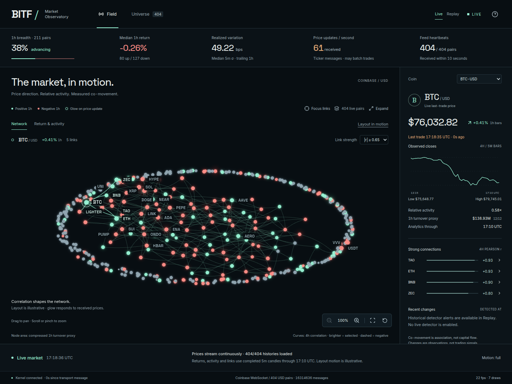

# BITF — Market Observatory

A live crypto market visualization: a fluid network of coins, measured correlations, and readable market telemetry. Built with React, Three.js, and a shared Python streaming kernel.



## What it does

- **Live market:** discovers online Coinbase USD pairs and subscribes to one shared public ticker/heartbeat WebSocket. Prices reach the UI in one-second snapshots.
- **Living network:** correlations shape the arrangement; incoming price updates brighten nodes. Independent drift and flexing connections are explicitly illustrative.
- **Measured view:** switch to a calibrated return-versus-activity chart. Select any asset for prices, relationships, coverage, and timestamps.
- **Explore:** zoom, pan, pinch, focus an asset, filter link strength, or expand to native fullscreen. Freeze the layout independently of the feed.
- **Replay:** a bundled, hash-verified recording lets you explore historical observations offline without mixing them with live prices.
- **Connection awareness:** stale prices keep their timestamps; disconnected feeds reconnect automatically. Missing measurements remain missing.

The universe is Coinbase Exchange USD markets, not every coin or exchange. Correlations use completed five-minute candles and have their own timestamp; they are not tick-by-tick measurements. No API keys, wallets, or exchange accounts are required. The tool does not place trades or establish a profitable strategy.

## Run locally

Requires **Python 3.12+** and **Node.js 22.13+**.

```sh
python3 -m venv .venv
. .venv/bin/activate
pip install -r requirements.txt
npm --prefix observatory ci
npm --prefix observatory run build
python -m bitf.observatory --port 8876
```

Open **http://127.0.0.1:8876**. Live mode is the default; use the header to select Replay, or open `http://127.0.0.1:8876/?mode=replay`.

Live mode needs network access to Coinbase's public WebSocket and REST endpoints. Historical replay works offline once dependencies are installed. Live prices appear first; candle history loads in the background, with major pairs prioritized. A source outage is shown explicitly and never replaced with replay.

For frontend development, keep the Python server running and run:

```sh
npm --prefix observatory run dev
```

The Vite server proxies API requests to port 8876. The Python server binds to loopback by default; `--host` and `--port` configure the bind address.

## Controls

| Action | Control |
| --- | --- |
| Inspect a coin | Click a node/label or use the coin selector and Universe search |
| Zoom / pan | Wheel or pinch / drag |
| Focus selected coin | Focus button, double-click its node, or `F` |
| Reset camera | Reset button or `0` |
| Keyboard camera | Focus the canvas, then arrow keys and `+` / `-` |
| Fullscreen | Expand; Collapse or `Esc` to return |
| Freeze layout | Layout in motion / Layout still |
| Replay | Play/pause, step, or scrub; `Space` outside other controls |

Operating-system reduced-motion preferences take precedence. The table and inspector remain usable when WebGL is unavailable.

[View the fullscreen screenshot](docs/screenshots/market-fullscreen.png).

## Architecture

```text
Coinbase ticker + heartbeat ──► shared last-trade state ─┐
Coinbase completed candles ──► shared analytics window ─┼─► latest snapshot ─► SSE ─► Three.js
Bundled historical recording ─► independent replay ─────┘
```

One upstream socket serves every viewer. Statistics are computed once, not per browser. Live clients receive the latest complete snapshot rather than accumulating an unbounded update queue. Replay viewers have independent cursors. The renderer uses instanced nodes, batched connections, and a worker for network layout.

See [data definitions and API](docs/data.md) for calculation windows, missing-data rules, feed behavior, and source details.

## Verify

```sh
python -m unittest discover -s tests -v
npm --prefix observatory run build
node --experimental-strip-types --test observatory/tests/*.test.ts
```

With the server running on port 8876 and Google Chrome installed, run browser checks **one at a time**:

```sh
python scripts/check_observatory_ui.py
python scripts/check_observatory_network.py
python scripts/check_observatory_fullscreen.py
python scripts/check_observatory_live.py
```

The live browser check needs Coinbase connectivity and uses a local test proxy to simulate disconnects and HTTP failures. Other browser checks use the bundled replay. Results go to ignored `artifacts/` directories. Screenshots in this README are real application captures; regenerate them with `python scripts/capture_observatory.py`.

## Project layout

```text
bitf/                    Shared live service, replay kernel, candle validation
observatory/             React + TypeScript + Three.js client
data/replay/            Compact public replay fixture and provenance
docs/                   Data definitions and screenshots
scripts/                Browser checks, capture, and local benchmark
tests/                  Focused backend tests
```

## Sources and acknowledgments

Market data comes from [Coinbase Exchange](https://docs.cdp.coinbase.com/exchange/websocket-feed/channels). Interface rendering uses [Three.js](https://threejs.org/), React, and Lucide. Self-hosted Inter and Space Grotesk retain their [font licenses](observatory/public/assets/licenses/).
